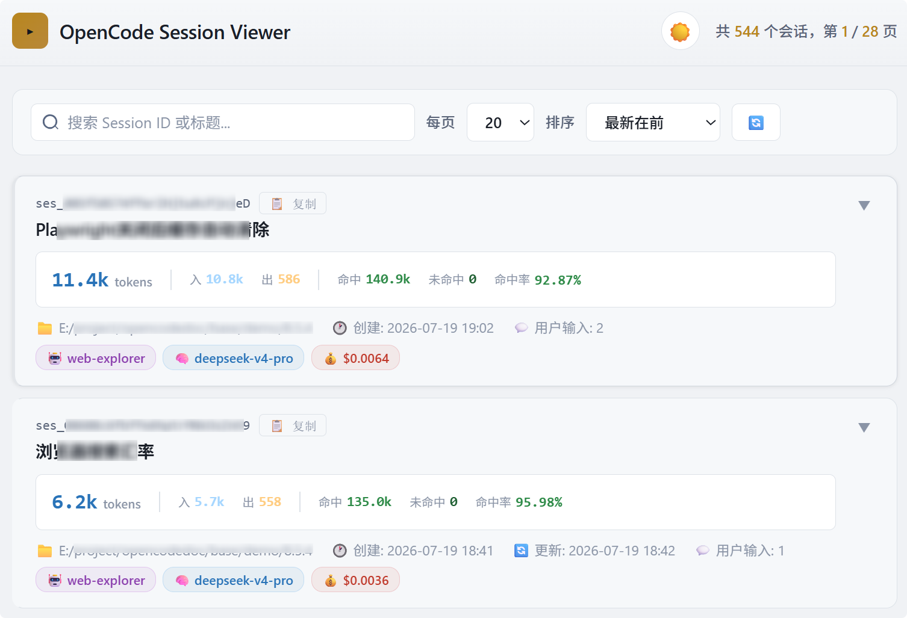

# OpenCode Session Viewer

浏览 OpenCode 全部会话历史的轻量 Web 工具，支持分页、用户输入回溯。

## 功能

- 📋 按创建时间浏览所有 session（分页 10 / 20 / 50）
- 💬 展开查看每个 session 最近 10 次用户输入
- 🔀 按用户输入一键 fork，包含该输入及之前的完整上下文
- 🖥️ 一键在 opencode 终端中打开指定会话（需安装 opencode CLI）
- 💰 展示 token 用量、成本、agent、model 等元信息
- 📂 路径独立显示，支持复制和一键打开所在文件夹
- ⚡ 纯 Python 标准库，零依赖

## 快速开始

```bash
# 方式一：双击 start.bat（Windows）
start.bat

# 方式二：命令行启动（自动打开浏览器）
python server.py

# 指定端口和数据库路径
python server.py --port 8765 --db "C:\path\to\opencode.db"
```

浏览器自动打开，无需手动操作。

## 数据库路径

默认读取 `%USERPROFILE%\.local\share\opencode\opencode.db`。

可通过环境变量 `OPENCODE_DB` 覆盖。

## 技术栈

- **后端**: Python 3 + http.server + sqlite3（全标准库）
- **前端**: 原生 HTML/CSS/JS，明暗双主题

## 截图

## License

MIT
